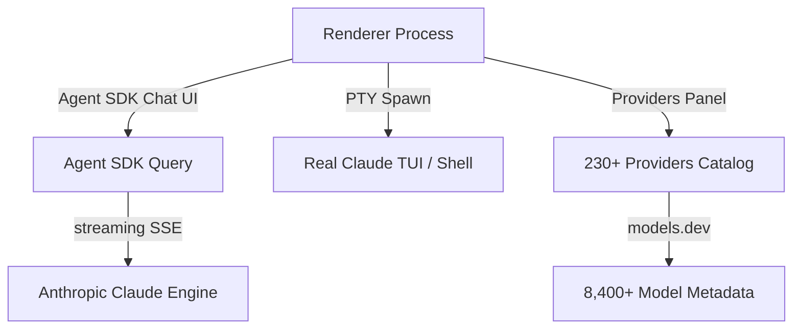

<div align="center">

<p align="center">
  
</p>

# Claude Code Enhanced (CCE)

<p align="center">
  <a href="https://github.com/printezy247/claude-code-enhanced/releases/latest"></a>
  <a href="https://github.com/printezy247/claude-code-enhanced/actions/workflows/ci.yml"></a>
  <a href="package.json"></a>
  <a href="https://github.com/printezy247/claude-code-enhanced/blob/main/LICENSE"></a>
  <a href="https://github.com/printezy247/claude-code-enhanced"></a>
  <a href="https://github.com/printezy247/claude-code-enhanced"></a>
</p>

<p align="center">
  <b>The Claude Code you know from the terminal — now a desktop app.</b><br>
  Agent SDK chat with tool cards and permission prompts, real <code>claude</code> TUI terminals, and a 230+ provider manager — all driving the real engine, nothing patched.<br>
  <sub>Electron · node-pty · @anthropic-ai/claude-agent-sdk · 230+ providers via models.dev</sub>
</p>

> **Desktop harness + Agent SDK chat + real TUI terminals + 230+ provider manager — for the Claude CLI.**

</div>

---

## 🏗 Overview



> Chat tabs never patch the CLI — the Agent SDK drives the real `claude` engine.

---

## ✨ Features

<details open>
<summary><b>🎯 Core Desktop Chat</b></summary>

- [x] Streaming responses with live thinking blocks
- [x] Tool-call cards with inline diffs
- [x] Live shell output inside the tool card while a command runs
- [x] Permission prompts in flow
- [x] Model selector mid-conversation
- [x] Mode selector (normal / accept edits / plan / yolo)
- [x] Skills panel + slash-command palette

</details>

<details>
<summary><b>🪟 Multiple Windows</b></summary>

- [x] `Ctrl+Shift+N` (or the **⧉ window** button) opens a second app window
- [x] Each window owns its own chats and terminal sessions
- [x] A window that closes takes its engine processes and ptys with it
- [x] `/detach` moves a chat to its own window (closes it here first, then the new window resumes the same conversation); the conversation list has *Open in new window*

</details>

<details>
<summary><b>⚡ Terminal Tabs</b></summary>

- [x] Real PTYs with genuine `claude` TUI

</details>

<details>
<summary><b>🪙 Token Saver</b></summary>

- [x] Shell output is compacted before the model reads it (head + tail, repeated
      lines collapsed) — the card still shows the full text
- [x] Budget is configurable (Settings → Chat behaviour), 500–100000 characters

</details>

<details>
<summary><b>🌐 Provider Manager</b></summary>

- [x] 230+ providers catalog (models.dev)
- [x] OAuth / API key auth
- [x] Test connection classification

</details>

<details>
<summary><b>🧭 Navigation and Overview</b></summary>

- [x] Overview side panel: Environment (one-line status, model, branch), Context, Connectors, Changes, Tasks, Background
- [x] **Sessions card**: every open chat with what it is doing (needs you, working, idle); click to switch. Redraws only when a chat's state changes
- [x] `Ctrl+1..9` jump to a tab, `Ctrl+Tab` cycles in most-recently-used order, `Alt+1..7` opens a tool-panel tab
- [x] `Ctrl+K` palette with prefixes: `>` commands, `@` files, `#` chats, `:` models
- [x] Jump-to-request rail on the chat's right edge (clears the floating Overview)
- [x] Tool panel: Changes, Files, Terminal, Diff, Review, Preview, Artifacts
- [x] **Search across conversations**: the sidebar search also looks inside stored conversation text ("Mentioned inside", with a snippet), plus a date filter (24 h / 7 d / 30 d)
- [x] **Monthly budget per project folder**: set a limit in the Environment card; warnings at 80% and when passed. Totals stay on this computer
- [x] **Remote folders over SSH**: for a chat that runs on another machine, the Files tab browses that machine's folders, shows a file as text and the folder's `git diff` (read-only)

</details>

<details>
<summary><b>✍️ Composer</b></summary>

- [x] Image thumbnails with Copy, Save, Remove and a larger view; images of an unsent message survive a crash (0600 files, never localStorage)
- [x] `Shift+Enter` continues a bullet or numbered list (`-`, `*`, `+`, `1.`); on an empty item it ends the list. Plain `Enter` sends
- [x] URL mentions, `@` file mentions, "Send again" when a send is refused
- [x] **Dictation**: a mic button, speech to text on this computer only (see *Optional local add-ons*)
- [x] Queue or steer while a turn is running

</details>

<details>
<summary><b>🧪 Side work, safely</b></summary>

- [x] **Side chat** from any of your messages: a read-only session branched from that turn, never reaches the main chat
- [x] `/btw <question>`: one side question while a turn runs
- [x] `/compare opus,sonnet <prompt>`: the same prompt to 2-4 models, answers side by side, each in its own read-only session
- [x] `/recipe`: saved chains of prompts (`/recipe save <name>`, steps split by `---`, `/recipe <name>` runs it). It pauses between steps with Continue / Stop; start the text with `auto` to skip the pause
- [x] **Scheduled prompts** on the Board (`every 30m`, `hourly`, `daily 09:00`): run while CCE is open, always read-only
- [x] Side and scheduled sessions fail closed: permission and connector questions are denied automatically
- [x] **Variants**: re-asked messages are remembered and reopenable after a restart

</details>

<details>
<summary><b>📎 Artifacts</b></summary>

- [x] Keep button on replies and code blocks; the same text is stored once
- [x] Artifacts tab (`Alt+7`): sanitized view, delete, PDF export through a hidden no-script, no-network window
- [x] **Versions**: saves with the same title are versions; pick an older one to see a line diff. *Export file* saves the shown version as .md or .txt

</details>

<details>
<summary><b>🧠 Model and chat control</b></summary>

- [x] Context advice at 75% and 90%, cache hit line
- [x] Model routing by task type (optional, per tier)
- [x] `/loop` and `/goal` with a goal banner
- [x] Per-chat output style and environment variables
- [x] CLI session titles kept in sync
- [x] **Export / Import settings**: one file with settings, workflows, recipes, shortcuts, pins and budget limits (no provider keys, connector logins or usage logs)

</details>

<details>
<summary><b>🌍 Web browser for the model (Lightpanda)</b></summary>

- [x] Per chat, **off by default**: chat menu → *Web browser (Lightpanda)*
- [x] You install the binary; CCE only looks for it and talks to it over a pipe (no network listener)
- [x] Tool calls follow the chat's permission mode; side and scheduled sessions never get it
- [x] Text browser: reads pages as text, no drawing, so it does not feed the Preview tab
- [x] Settings: sites to block (Lightpanda has no allow-list option, so this is a block list), block private network addresses, and keep cookies between chats in one file (all off by default)

</details>

<details>
<summary><b>♿ Accessibility</b></summary>

- [x] Skip-to-content link, a page heading, named controls (a live-UI test fails on any unnamed button, field or image)
- [x] Contrast and focus-ring ratios computed from the palette in both themes
- [x] 11 px text floor, icon-only controls always have a tooltip and a name

</details>

---

## Install

```bash
# from the repo root
VER=$(node -p "require('./package.json').version")
sudo apt install ./dist/claude-code-enhanced-${VER}-amd64.deb
# or: sudo dpkg -i dist/claude-code-enhanced-${VER}-amd64.deb
```

Launch **Claude Code Enhanced** from your application menu, or run `claude-code-enhanced`.

Requirements: the [claude CLI](https://github.com/anthropics/claude-code)
(`curl -fsSL https://claude.ai/install.sh | bash`) — the app auto-detects it at
`~/.local/bin/claude`, `/usr/local/bin/claude`, etc.; you can override the path in Settings.

## Optional local add-ons

CCE never downloads anything on its own. Both add-ons are commands you run yourself.

**Dictation** (speech to text, offline after the one-time model fetch):

```bash
python3 -m venv ~/.local/share/cce-dictation
~/.local/share/cce-dictation/bin/pip install faster-whisper
~/.local/share/cce-dictation/bin/python -c "from faster_whisper import WhisperModel; WhisperModel('base.en')"
```

**Lightpanda** (headless browser the model can use; AGPL-3.0 licensed):

```bash
mkdir -p ~/.local/share/lightpanda
curl -L -o ~/.local/share/lightpanda/lightpanda https://github.com/lightpanda-io/browser/releases/download/nightly/lightpanda-x86_64-linux
chmod a+x ~/.local/share/lightpanda/lightpanda
```

## Build from source

```bash
npm install        # also compiles node-pty for Electron
npm start          # run unpackaged
npm test           # vitest: main-process units + renderer (jsdom) tests
npm run smoke      # headless boot check under xvfb
npm run dist       # build dist/claude-code-enhanced-<version>-amd64.deb
```

## Using providers

1. **Providers** panel → **+ Add provider** opens the **Connect** picker. Search 230+ providers
   (every models.dev provider plus curated ones); filter by *Subscriptions / Cloud / Gateways /
   Local*.
2. Pick one. If its URL needs values (Cloudflare account id, Azure resource, an AI Gateway id)
   you are asked for them, then the provider is created and its detail panel opens.
3. In the panel's tabs:
   - **Auth** — paste an API key, or **Sign in** (OAuth / device code). *Test connection* checks
     the credential and lists how many models the provider serves.
   - **Models** — tick what appears in the chat dropdown, set the default model. Metadata
     (context window, cost, tool-calling) comes from models.dev.
   - **Options** — base URL, protocol (Anthropic / OpenAI chat / OpenAI Responses / Gemini),
     auth header, default + small model, extra headers.
   - **Advanced** — lean tool set (for small local models) and extra environment variables.
   - **Diagnostics** — last test result and the exact env a session will get.
4. Star a provider to make it the default; **disable** one to keep it out of pickers.
5. Anthropic subscription users can also just tick **Send /login after launch** in a session.

Secrets are stored in `~/.config/claude-code-enhanced/auth.json` (`0600`, encrypted with the OS
keyring when available) and are **never** written to `config.json`, so the config can be shared.
`~/.config/claude-code-enhanced/config.json` (`0600`) keeps provider records and settings.

Provider quirks worth knowing:
- **Amazon Bedrock** uses a region-templated URL (`bedrock-runtime.${REGION}.amazonaws.com/openai/v1`).
  It has no `GET /models` endpoint, so CCE tests it with a one-token completion probe and lists models
  from the models.dev catalog. Paste a long-term Bedrock API key (starts `ABSK…`); SigV4/IAM-credential
  users should put AWS creds in the environment instead.

## Using connectors

1. **Connectors** panel → pick a scope (`user` = all projects, `project` = `.mcp.json`).
2. Click **Add connector** — it runs `claude mcp add --transport http <name> <url> --scope …`.
3. In any terminal session, run `/mcp` and choose **Authenticate** for the OAuth popup.
4. Each card shows a live status chip (**connected**, **sign-in needed**, **failed** with the reason on hover,
   or **not added**) from `claude mcp list`; the button turns into **Remove** once a connector is added.
   **Your connectors** below lists every server with its status. Press **↻ Refresh** to re-check.
5. Another GitHub account: use **GitHub — another account** (a name such as `github-work` plus that account's
   token). Each account is its own server; tokens are redacted from error messages.

## Permission modes

The footer picker has the four modes of the Claude Code desktop app:

| Mode | Runs without asking | Still asks |
|---|---|---|
| **auto** | everything, after a second model (the *classifier*) reviews each action | — (pauses to ask after repeated blocks) |
| **accept edits** | file reads and edits, simple file commands (`mkdir`, `mv`, `cp`…) | shell commands and anything else |
| **plan** | reads only — the agent proposes a plan and changes nothing | everything until you approve the plan |
| **yolo** | everything, unchecked | nothing — use only in throwaway folders or containers |

Claude Code's "manual" mode (ask before every edit) is not offered; it maps to **accept edits**, the closest safe choice.

**auto runs on two different engines.** On Anthropic's own API a second model (the *classifier*) reviews each action. Behind a third-party provider (Qwen, GLM, a local model, any translating proxy) that classifier cannot be trusted — its answers do not parse and Claude Code silently denies actions, then stops the turn after ten no-verdict replies — so cce keeps **auto** available but runs it with its own safe-action policy instead: the engine is set to *accept edits* and CCE approves plainly safe actions itself (`echo` runs, `sudo rm -rf …` still asks).

**Auto-continue.** Some models end a turn on "Let me …" without making the tool call, so the chat goes quiet. cce sends one automatic reminder per prompt (Settings → Chat behaviour); the **▶ continue** button is always there.

## Architecture

```
┌────────────────────────── Electron ──────────────────────────┐
│ renderer                     ↔        main process           │
│  • chat tabs (Agent SDK UI)        • chats.js → @anthropic-   │
│    messages, tool cards,             claude-agent-sdk query() │
│    permissions, model/mode           streaming-input sessions │
│  • terminal tabs (xterm.js)        • sessions.js → node-pty   │
│  • providers / connectors /          spawns `claude` / shell  │
│    settings panels                 • providers env injection  │
└───────────────────────────────────────────────────────────────┘
        ↕ child_process (claude mcp add/list/remove)
   claude CLI config (~/.claude.json, .mcp.json, ~/.claude/skills)
```

Chat tabs never patch the CLI — the Agent SDK drives the real `claude` engine
(streaming input, permission callbacks, session resume), so skills, hooks, MCP
servers and settings from `~/.claude` all apply exactly as in the terminal.

### IPC surface (main ↔ renderer)

The main channels (not exhaustive — see `src/preload/preload.js` for the full bridge):
`session:create/write/resize/kill` · `pty:data` / `pty:exit` events ·
`providers:all/save/delete/default/test` · `provider:listModels` ·
`connectors:presets/list/add/remove` · `settings:get/set` · `clipboard:write` ·
`dialog:pickDir`

### Conversations

The **▤ Conversations** button in the tabbar opens a dropdown covering both open chat/terminal
tabs and every stored session — no separate Sessions or History tabs:

- grouped by the **folder** the conversation ran in, with time buckets (Today / Yesterday /
  Earlier this week / Older) inside each group
- **sort** dropdown (newest / oldest / by name) and a **folder filter**
- **▾ per row**: open, fork, read-only transcript, export to markdown, new chat in that folder,
  delete (two-step confirm)
- clicking a row resumes that session live, with its transcript restored
- `Ctrl+B` toggles the dropdown, `Esc` closes it, clicking outside closes it

## Keyboard

`Ctrl+Shift+T` new session · `Ctrl+Shift+W` close tab · `Ctrl+1..9` jump to tab ·
`Ctrl+Tab` next tab (most recently used) · `Ctrl+Shift+N` new window · `Ctrl+K` command palette
(`>` commands, `@` files, `#` chats, `:` models) · `Ctrl+B` conversation list · `Ctrl+\` sidebar ·
`Alt+V` tool panel · `Alt+1..7` tool-panel tabs · `Shift+Enter` newline, continues a list ·
`Esc` stop / close panel · `Ctrl+Shift+C/V` copy/paste (terminal tabs only)

Slash commands added by CCE: `/compare` · `/recipe` · `/detach` · `/btw` · `/loop` · `/goal` · `/compact` · `/review`

## References

- [anthropics/claude-code](https://github.com/anthropics/claude-code) — the wrapped CLI
- [Alishahryar1/free-claude-code](https://github.com/Alishahryar1/free-claude-code) — FCC:
  multi-provider routing + the terminal-first UX this app reproduces
- [shareAI-lab/learn-claude-code](https://github.com/shareAI-lab/learn-claude-code) — CLI
  internals research
- [ChinaSiro/claude-code-sourcemap](https://github.com/ChinaSiro/claude-code-sourcemap) —
  CLI source maps
- [hesreallyhim/awesome-claude-code](https://github.com/hesreallyhim/awesome-claude-code) —
  enhancement ecosystem (commands, hooks, MCP)
- [Donchitos/Claude-Code-Game-Studios](https://github.com/Donchitos/Claude-Code-Game-Studios) —
  workflow/prompt collections
- Connector endpoints: [Supabase remote MCP](https://supabase.com/blog/announcing-supabase-remote-mcp-server),
  [lovablelabs/mcp](https://github.com/lovablelabs/mcp), [GitHub MCP server](https://github.com/github/github-mcp-server)

## Small local models

The claude engine's own base prompt (skills + plugins) is already around 66K tokens, so a chat
needs a context of about 70K or more, and a 3-4B model on a small GPU is slow at that size
(the first turn can take many minutes). Three things in this app attack that:

- **Lean tools** — cut the tool list for one provider (Providers → Edit: three presets or a
  custom per-tool checklist) or globally (Settings → Small local models). Fewer tool schemas
  means a smaller prompt.
- **Tool-call repair** — local models often emit a tool call as prose
  (`<tool_call>{…}</tool_call>` or bare JSON). Local providers are routed through the
  built-in translator proxy, which parses that back into a real tool call.
- **Context sizing** — Ollama loads a model at its own default context (4096 on a 4 GB GPU),
  which silently truncates the engine's prompt and produces nonsense replies. The Ollama
  manager therefore creates a derived copy of the model with the context baked in (default
  72K, see Settings → Local models) and loads that, stepping the size down if it does not fit
  in free RAM. Larger sizes use much more memory (128K needs ~14 GB for a 4B model). **Force
  context** (Settings → Local models, one `model=number` per line) skips the 70K floor for a
  named model — only for models you know; the engine usually rejects turns past a model's real
  context.

Check a model's track record in the model picker: the percentage is measured from your own
tool calls on this machine.

## Tests

`npm test` runs vitest with two harnesses:

- **main process** — `test/stubs/electron.js` replaces Electron, so `src/main/*` runs in plain
  node. `chat:create` uses a fake Agent SDK, and the proxy tests use local fake HTTP servers.
- **renderer** — `test/helpers/renderer.js` boots `index.html` in jsdom, installs a recording
  `ccx` bridge, and evaluates `chat.js` + `app.js` in one shared scope.

No network access and no API keys are required. The same suite runs on every pull request and
every push to `main` via GitHub Actions (`.github/workflows/ci.yml`).

- `npm run lint` — lints the built `.deb` with lintian (suppressions are documented in `scripts/lint.sh`)
- `npm run changelog` — regenerates `CHANGELOG.md` from `git log` since the latest tag
- Stryker mutation testing is configured in `stryker.config.json` (opt-in: install stryker, then `npx stryker run`)

## Troubleshooting

- **`node-pty failed to load`** → `npm run rebuild`
- **Blank window on exotic kernels** → do *not* run with `--no-sandbox`; the default
  Chromium sandbox is required for renderer shared memory on this machine's kernel.
- **claude not found** → Settings → Claude CLI → *Auto-detect*, or install via install.sh.

## 🚀 Roadmap

### Shipped

- [x] Multi-window (one engine process per window) and `/detach`
- [x] Streaming Bash output inside tool cards
- [x] RTK-style output filtering to cut token usage
- [x] Overview with a Sessions card, chord navigation, palette prefixes
- [x] Artifacts (with versions and export), side chat, `/btw`, scheduled prompts, variants
- [x] Local dictation and a per-chat Lightpanda browser (block list, cookies)
- [x] Composer image previews and list continuation
- [x] Front-End Checklist accessibility pass (run through Lightpanda inside CCE)
- [x] Search across conversations, monthly folder budgets, settings export / import
- [x] `/compare` and `/recipe`
- [x] Read-only remote folders over SSH

### Proposed (options, not promises)

**Agents and automation**
- [ ] Scheduled prompts that also run while CCE is closed (opt-in, still read-only, via a user systemd timer)
- [ ] A text "what the model saw" view next to the Preview tab
- [ ] Recipes that fan out: run a step on several models and carry the best answer on
- [ ] Compare answers token by token as they stream, with a cost estimate before sending

**Workspace**
- [ ] Artifact export as a zip, and a model filter in conversation search
- [ ] Edit and save files on a remote machine (today it is read-only)
- [ ] Settings sync between two of your own computers through a folder you choose

**Cost and models**
- [ ] A weekly spend digest on the Board
- [ ] Local model benchmark and a "best model for this task" suggestion from your own history
- [ ] A bundled offline speech engine option, so dictation needs no setup

**Platform and quality**
- [ ] Signed auto-update channel from the CI artifact
- [ ] macOS and Windows builds
- [ ] Mod API for panels and slash commands
- [ ] Full WCAG 2.2 AA pass with real screen-reader testing, reduced motion, a high-contrast theme
- [ ] More interface languages (English, Spanish and German exist)
